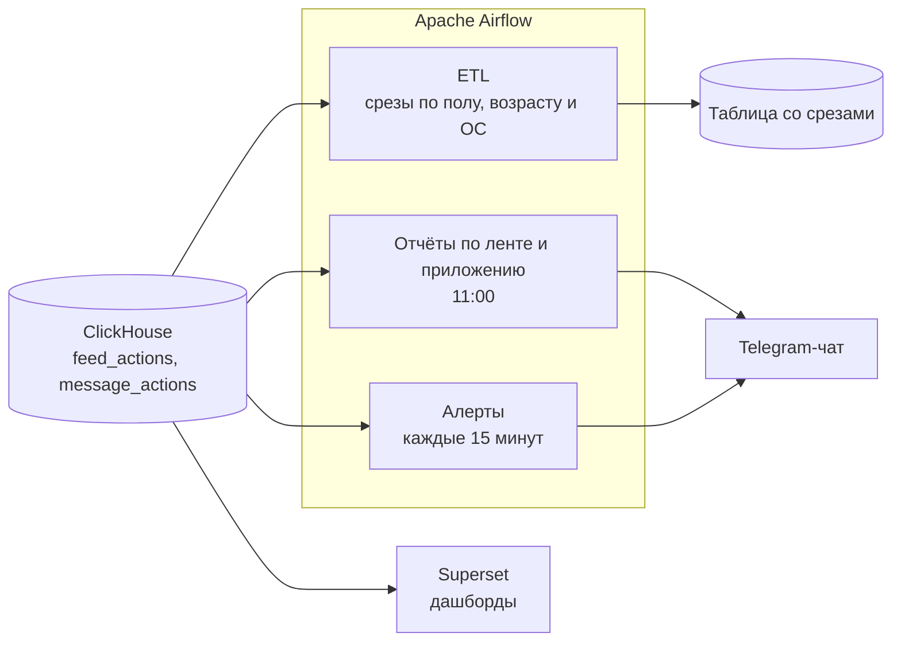

# Автоматизация отчётности и мониторинга для приложения (лента + мессенджер)


Набор автоматических пайплайнов, которые заменяют ручную работу аналитика: считают метрики приложения, присылают ежедневные отчёты в Telegram, следят за аномалиями каждые 15 минут и показывают картину целиком на дашбордах.

> Учебный проект выполнен в рамках курса «Симулятор Аналитика» ([ООО «Карпов Курсы»](https://karpov.courses)). Данные и параметры доступа к базе курса в репозитории **не публикуются**.

## Задача

У приложения два продукта: **лента новостей** (просмотры и лайки) и **мессенджер** (отправка сообщений). Пользователи начали жаловаться на сбои, а о проблемах команда узнавала постфактум. Нужно:

1. каждый день получать готовые данные для анализа без ручных выгрузок;
2. каждое утро видеть сводку по приложению целиком, а не только по ленте;
3. узнавать об аномалиях в течение 15 минут, а не на следующий день;
4. иметь дашборды для самостоятельного исследования.

## Что внутри

| Компонент | Ноутбук (разработка) | DAG (продакшн-код) | Расписание | Результат |
|---|---|---|---|---|
| ETL-пайплайн | [`01_etl_pipeline.ipynb`](notebooks/01_etl_pipeline.ipynb) | [`dags/etl_dimensions.py`](dags/etl_dimensions.py) | ежедневно, за вчера | таблица метрик в разрезах пол / возраст / ОС в ClickHouse |
| Система алертов | [`02_alerts_system.ipynb`](notebooks/02_alerts_system.ipynb) | [`dags/alerts.py`](dags/alerts.py) | каждые 15 минут | сообщение с графиком в Telegram при аномалии |
| Отчёты в Telegram | [`03_telegram_reports.ipynb`](notebooks/03_telegram_reports.ipynb) | [`dags/feed_report.py`](dags/feed_report.py), [`dags/app_report.py`](dags/app_report.py) | ежедневно, 11:00 | текст + графики + CSV в чате |
| Дашборды | — | — | — | [Superset](#дашборды-superset) |

Ноутбуки содержат разработку и отладку логики (запросы, выбор метода, проверки), а в папке `dags/` лежит итоговый код, который запускается в Airflow.

## Архитектура



## 1. ETL-пайплайн

DAG, который каждый день считает метрики **за вчера** и дописывает их в таблицу ClickHouse.

```
extract_feed ──────┐
                   ├─> merge_tables ─┬─> transform_os     ─┐
extract_messages ──┘                 ├─> transform_gender ─┼─> load
                                     └─> transform_age    ─┘
```

- **`extract_feed`**: по каждому пользователю число просмотров и лайков из `feed_actions`.
- **`extract_messages`**: по каждому пользователю из `message_actions` число отправленных и полученных сообщений, скольким пользователям он писал и сколько людей писали ему.
- **`merge_tables`**: объединение двух выгрузок по `user_id` (outer join, чтобы не потерять ни тех, кто только читал ленту, ни тех, кто только писал). У пользователей, которые только получали сообщения, атрибуты (пол, возраст, ОС) подтягиваются из справочника.
- **`transform_*`**: три параллельных таска, по одному на каждый срез.
- **`load`**: запись в таблицу и защита от дублей при перезапуске (если данные за день уже есть, загрузка пропускается).

Структура итоговой таблицы:

| Столбец | Тип | Описание |
|---|---|---|
| `event_date` | Date | дата |
| `dimension` | String | название среза: `gender`, `age`, `os` |
| `dimension_value` | String | значение среза |
| `views`, `likes` | Int64 | просмотры и лайки ленты |
| `messages_received`, `messages_sent` | Int64 | полученные и отправленные сообщения |
| `users_received`, `users_sent` | Int64 | от скольких пользователей получили / скольким отправили |

> Показатели `users_received` и `users_sent` суммируются по пользователям среза, поэтому один и тот же собеседник может быть посчитан несколько раз.

## 2. Ежедневные отчёты в Telegram

Каждый день в 11:00 в чат приходят два отчёта.

**Отчёт по ленте** (`feed_report.py`): одним сообщением график и подпись с DAU, просмотрами, лайками и CTR за вчера; на графике те же метрики за 7 дней.

**Отчёт по приложению целиком** (`app_report.py`) приходит тремя сообщениями: **текст**, **три графика** (приложение в целом, лента, мессенджер) и **CSV-файл** с данными за 8 дней. Он отвечает на вопросы бизнеса о продукте в совокупности:

| Вопрос | Метрики |
|---|---|
| Сколько людей пользуется приложением? | DAU приложения (лента ∪ мессенджер), DAU ленты, DAU мессенджера |
| За счёт чего растёт аудитория? | новые и вернувшиеся пользователи, новые по источникам (ads / organic) |
| Связаны ли лента и мессенджер? | структура аудитории: только лента / только мессенджер / оба продукта |
| Как работает лента? | просмотры, лайки, CTR, просмотров на пользователя |
| Как работает мессенджер? | сообщения, отправители, получатели, сообщений на отправителя |

Для каждой метрики показано изменение к предыдущему дню и к тому же дню неделей ранее. В конце блок **«На что обратить внимание»**: туда автоматически попадают ключевые метрики, изменившиеся на 10% и больше к прошлой неделе.

<!-- Добавьте сюда скриншот отчёта в Telegram (закройте название чата и имена):  -->

## 3. Система алертов

Каждые 15 минут DAG проверяет последнюю завершённую 15-минутку по шести метрикам и трём срезам.

- **Метрики:** активные пользователи ленты, просмотры, лайки, CTR, активные пользователи мессенджера, отправленные сообщения.
- **Срезы:** приложение целиком, `os`, `source`. Срезы нужны, чтобы замечать поломки, которые растворяются в общей цифре (например, сломалась кнопка лайка только на iOS).

### Метод

Статистический, по **межквартильному размаху (IQR)** для конкретного времени суток, чтобы интервал не был «средним по больнице»:

1. Для проверяемой 15-минутки берём значения той же 15-минутки и двух соседних за предыдущие 14 дней (42 точки).
2. Считаем допустимый диапазон:

   ```
   [ q25 − 3 · IQR ;  q75 + 3 · IQR ]
   ```

3. Чтобы не реагировать на мелкий шум, запас не меньше 10% от медианы.
4. Метрики с малым объёмом не проверяются (медиана меньше 20 событий за 15 минут, для CTR меньше 200 просмотров).
5. Значение вне диапазона запускает алерт. За один запуск отправляется не более 5 алертов, остальные списком.

IQR выбран вместо правила трёх сигм: он устойчив к выбросам в истории (прошлые сбои и акции не раздувают допуск). Параметры подбираются функцией `backtest()` (какие алерты сработали бы за последние двое суток), она показана в ноутбуке `02_alerts_system.ipynb`.

### Формат алерта

В алерте: метрика, срез, текущее значение, отклонение от нормы и от значения «день назад», график за 24 часа (сейчас, день назад, зона нормы). Пример формата (значения условные):

```
🚨 Метрика «Лайки» в срезе: os = iOS.
Текущее значение: 1 170 (за 01.11 14:00–14:15).
Отклонение от нормы для этого времени: -63.5% (ниже нормы). Норма ≈ 3 200, допустимо 2 540 – 3 880.
К значению день назад: -64.2% (было 3 270).
```

<!-- Добавьте сюда пример графика алерта:  -->

## Дашборды Superset

Дашборды построены в Apache Superset поверх таблиц ClickHouse. SQL всех чартов лежит в [`sql/`](sql/).

### Результаты рекламной кампании


Чарты: DAU, когортная тепловая карта удержания, удержание по источникам, DAU по источникам, количество событий по городам.

**Что показал анализ:**

- Рекламная кампания началась **13 августа**: с этой даты заметен рост DAU.
- Удержание пользователей, пришедших через рекламу, **значительно ниже**, чем у органических: для когорты 13 августа на 30 августа около 2% против 15%. Это повод пересмотреть рекламные каналы и работу с удержанием.
- **Просадка 22 августа** затронула оба источника трафика (ads и organic), значит, причина не связана с рекламной кампанией. В этот день нет ни одного события от пользователей из крупных городов (Москва, Екатеринбург, Новосибирск, Самара). Данных недостаточно для точной причины, но наиболее вероятна техническая поломка.

<!-- Добавьте остальные дашборды по тому же шаблону: заголовок, скриншот, список чартов, выводы -->

## Структура репозитория

```
reporting-automation/
├── README.md
├── notebooks/
│   ├── 01_etl_pipeline.ipynb
│   ├── 02_alerts_system.ipynb
│   └── 03_telegram_reports.ipynb
├── dags/
│   ├── etl_dimensions.py
│   ├── alerts.py
│   ├── feed_report.py
│   └── app_report.py
├── sql/                   — запросы чартов Superset и ETL
├── dashboards/            — скриншоты дашбордов
└── images/                — примеры отчётов и алертов
```

## Технологии

Python (pandas, numpy, matplotlib, requests, pandahouse) · Apache Airflow (TaskFlow API, расписания по cron) · ClickHouse · Telegram Bot API · Apache Superset · Git.

## Как повторить

1. В начале каждого DAG-файла замените заглушки своими значениями: параметры подключения к ClickHouse, `TELEGRAM_TOKEN`, `CHAT_ID`, имя таблицы для ETL и `owner`. **Не публикуйте реальные пароли и токены.**
2. Бот создаётся через [@BotFather](https://t.me/BotFather), его нужно добавить в нужный чат. `chat_id` можно получить через метод `getUpdates`.
3. Положите DAG-файлы в папку `dags/` вашего Airflow, дождитесь появления DAG в интерфейсе и включите его.
4. Для проверки без Telegram установите в DAG-файлах `SEND_TO_TELEGRAM = False`: отчёты и алерты будут печататься в лог.

Библиотеки, доступные в Airflow при разработке: `matplotlib 3.3.2`, `pandahouse 0.2.7`, `requests 2.26.0`, `python-telegram-bot 13.7`. Код написан под них (отправка в Telegram через `requests`, без зависимости от версии Telegram-библиотеки).

## Ограничения и что можно улучшить

- Алерт повторяется каждые 15 минут, пока аномалия держится. Дальше можно хранить историю отправленных алертов и не дублировать их.
- Окно в 14 дней смешивает будни и выходные. Если ложных срабатываний будет много, стоит сравнивать с тем же днём недели.
- Если данные поступают в таблицы с задержкой, последняя 15-минутка может быть занижена и дать ложное срабатывание.
- Время запуска в Airflow задаётся в UTC, время в алертах указано по часам сервера ClickHouse.
- «Новый пользователь» в отчёте означает первое появление в приложении (в ленте или мессенджере), а не дату регистрации.
- В алерты можно добавить ссылку на дашборд и тег ответственного за метрику.
- Секреты лучше хранить в переменных окружения или в Airflow Variables, а не в коде.

## Авторство

Автор: Дарина Радвилович · [GitHub](https://github.com/ddanwit)

Учебный проект выполнен в рамках курса «Симулятор Аналитика», ООО «Карпов Курсы», <https://karpov.courses>. Условия учебных заданий принадлежат ООО «Карпов Курсы» и использованы с указанием авторства. Данные учебной базы и информация о доступе к ней в репозиторий не включены.
